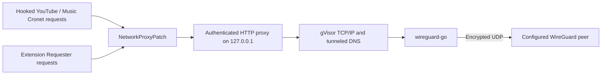

# Design and upstream integration

## Existing network path

Morphe already provides app-specific Network proxy patches backed by shared
`BaseNetworkProxyPatch`, `NetworkProxyPatch` and `CronetTransport` code. The patch
configures `CronetEngine.Builder.buildExperimental()`, registers built engines,
records the main engine, and installs a `Requester.ConnectionProvider` during the
app's own application/activity initialization. HTTP extension requests needing
proxy credentials use the existing plaintext HTTP connection wrapper; HTTPS
extension requests use registered Cronet engines.

YouTube requires the existing 20.47.62 version gate. The proxy-list overload is
chosen by the existing YouTube 21.12 and Music 9.20 version flags. Those choices
are reused; WireGuard does not invent a second Cronet compatibility matrix.

The proxy API fingerprints reference public, unobfuscated `org.chromium.net`
types and methods. The main-engine fingerprint uses the existing distinctive
`Could not create CronetEngine` string. App initialization fingerprints are
reused. The new inclusion fingerprint targets Morphe's own extension method.
There is no new dependency on an obfuscated app class or method name. Actual
fingerprint uniqueness still requires Desktop `--validate` against target APKs.

The shared-youtube extension library is already linked by both app extensions.
It contains the common Java runtime, storage and settings Activity. Each app
declares only its own dependency, compatibility and settings placement. English
strings live in `patches/src/main/resources/addresources/values/shared-youtube/`;
translated `values-*` files remain managed by Crowdin.

## Integration alternatives

| Consideration | Extend Network proxy into one patch | Separate WireGuard patch depending on Network proxy |
| --- | --- | --- |
| Existing working code | Requires combining transport choices and their UI/lifecycle | Preserves the existing app declarations and runtime |
| Request hooks | Can share current hooks | Reuses exactly the same hooks through a dependency |
| Native payload | Becomes part of every Network proxy installation unless more selection logic is added | Installed into an APK only when WireGuard is applied |
| Settings | Must combine remote HTTP proxy fields with encrypted profile operations | Keeps HTTP/HTTPS fields and the profile Activity distinct |
| Security policy | Must prevent ordinary proxy fallback controls from changing WireGuard policy | WireGuard always takes precedence and forbids direct fallback |
| Maintenance | Fewer public patch names, larger combined feature surface | Two small app declarations; shared engine/runtime remain single implementations |
| Build cost | Native cost still exists if the official bundle includes the feature | Native cost still exists in official bundle CI; selection does not remove that cost |
| Future SOCKS5 work | Risks conflating protocol selection and embedded tunnel ownership | Allows future proxy protocol work to remain independent |

Retain separate `WireGuard proxy (experimental)` patches depending on the
corresponding Network proxy patch. Their small adapters do not justify a large
runtime rewrite. WireGuard's process mode chooses the authenticated local proxy
with direct fallback disabled; ordinary HTTP/HTTPS proxy preferences retain their
existing behavior when WireGuard is off. Applying both patches does not create
two competing hook sets.

Default patch selection and runtime enablement are separate. Both WireGuard
patches remain `default = true`, as requested for regression compatibility with
v2.1.1, while `WIREGUARD_ENABLED` remains `false`. This also selects Network proxy
as a dependency. Maintainers should review the default-selection cost explicitly
because Network proxy is normally opt-in upstream.

## Configuration, startup and restart

The Activity imports a bounded UTF-8 document through Android's document picker,
validates the supported profile subset without contacting a peer, and encrypts
the profile. It uses no broad storage permission. Each app has its own private
files, AndroidKeyStore namespace and saved connection setting.

Mode is latched once for each process. The saved flag does not reroute existing
Cronet engines in place. Enabling, disabling, replacing or deleting the profile
requires restarting the app. When enabled requests first need the endpoint, the
native engine starts with fresh random proxy credentials and an ephemeral IPv4
loopback port. A ready listener does not establish that the peer handshook or that
Internet access works.

The Java bridge lazily loads `libmorphewireguard.so`. A disabled process does not
load it or start the WireGuard engine, listener, keepalives or network workers.
An explicit import/enable operation may validate a profile even while routing is
off; this is user-triggered work, not background connection activation.

The native engine owns one WireGuard device and userspace TCP/IP stack. Its close
operation cancels dials and requests and closes listener/transport/active streams,
including HTTP CONNECT streams. JNI serializes its process-local engine slot.
Normal app use retains the engine for that process; closing the settings Activity
must not stop playback. Android process death releases process resources. No
foreground service or guaranteed Android background execution is introduced.

There is no new Android network callback or automatic profile/endpoint selection.
The transport uses upstream WireGuard's default UDP bind and protocol retry
behavior. Wi-Fi/mobile changes, IPv4/IPv6 changes, long background suspension and
recovery remain Android acceptance cases; general WireGuard roaming support does
not prove that this app integration recovers without a restart.

## Failure boundary

For WireGuard mode, hooked builders disable QUIC and receive one local HTTP proxy
with direct fallback disallowed. Requester requires a proxy-configured Cronet
engine, or the authenticated local plaintext HTTP path. The ordinary proxy's
allow-direct preference cannot override this policy.

Profile/native startup failure creates a rejection-only local endpoint. If even
safe local setup or proxy-option installation fails, the affected hooked engine
construction must fail. Native destination DNS and application TCP dials have no
host-network alternative. Resolved addresses must fit `AllowedIPs`; missing or
out-of-route DNS is rejected during profile validation.

This boundary covers requests actually handed to those hooks. Unhooked native
code, WebViews, other app processes, GmsCore, Cast and unrelated apps require
separate investigation and are not protected by a system kill switch.

## Build and maintenance impact

The new build inputs are Go, Android NDK and the pinned Go module graph in
`native/wireguard/go.mod`/`go.sum`. Both native ABIs are built from source. The
Gradle resource task puts them in the patch bundle; the patch copies only the
supported ABIs already present in the target APK. The shared extension `.mpe`
packaging is not assumed to merge arbitrary native files into the app.

The installer checks the selected payload's ELF class, byte order, shared-object
type and machine. It sets native extraction for loading and registers a
non-exported settings Activity. Separate bundle inspection checks JNI symbols,
DEX signatures, resources and notices. ELF inspection does not execute Android
code or establish app compatibility.

The official PR/release build must create the payload before bundling and run the
new host checks. Native source, pinned checksums and license texts are reviewed;
vendored module trees, prebuilt `.so` files and the prototype's source snapshots
are not needed in the contribution. Normal upstream dependency versions, patch
bundle metadata, signing and release conventions stay upstream-owned.

Ongoing maintenance includes Go/NDK/module updates, gVisor/WireGuard API changes,
JNI/16 KiB page compatibility, AndroidKeyStore/import behavior, Cronet proxy API
changes and the two-app version matrix. This is substantially more responsibility
than adding a SOCKS5 selector. Dependency upgrades should repeat engine failure,
DNS/routing, lifecycle, Android build and representative device tests.
